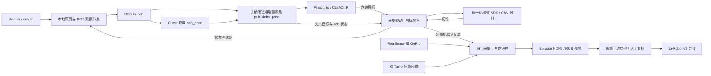

# 当前采集架构与操作流程

`Data_Collect/` 是独立部署单元；程序、ROS 包、SDK、模型、网页和配置均在此目录。默认机械臂 Piper-X，TCP 为 `[0,0,0.195,0,0,0]`，位置单位 m、角度单位 rad。

相机启动时自动选择双 RealSense 或 GoPro HDMI/UVC；默认 GoPro 方案只有一路手腕 RGB，相机/触觉流清单随录制保存，审核、预览与导出按实际清单读取。RealSense worker 保持原样；GoPro 按 UMI 的独立连续读取模式采集，并使用实测接收延迟进行离线画面时间对齐。配置、首次标定与暂停边界处理见 [相机说明](cameras.md)。

## 进程与数据流



- **工作台进程**：本机 HTTP 服务、ROS 状态观察和启动进程管理。只观察，不重复连接 CAN 或图像 SDK。默认端口 8766。
- **Quest 两个节点**：`pub_pose.py` 发布坐标修正后的位姿；`pub_delta_pose.py` 读取按钮、对齐当前手柄/TCP，按约 30 Hz 发布增量末端目标和夹爪目标。
- **IK 节点**：求解六轴关节位置，URDF 限位作为优化约束；结果写入 `/teleop/joint_states`。
- **机械臂与采集驱动进程**：继承内部 `agx_arm_ctrl`，聚合六轴和夹爪目标，按 50 Hz 走原驱动的 SDK 路径。SDK 访问使用同一锁；反馈按 200 Hz 轮询、展示反馈按 30 Hz 发布。
- **独立采集/写盘进程**：隔离 RealSense / GoPro、Tac-X、图像编码与 HDF5 工作。机器人记录通过有界队列传输，图像不穿过机械臂控制进程。RGB 保存为视频，触觉原始图像无损保存。

## 模块职责

| 目录 | 职责 |
|---|---|
| `cli/` | GUI、审核、导出、延迟测量的命令入口 |
| `application/` | 遥操状态、录制启动/封盘、独立故障报告 |
| `control/` | 七维目标聚合、SDK 读写观察、FK 数据记录与显示 |
| `sensors/` | 双相机、双触觉和独立采集进程 |
| `recording/` | Episode、HDF5、视频、队列和录制数据准入 |
| `web/` | 遥操工作台和离线人工审核页面 |
| `dataset/` | 20 Hz 因果对齐、自动质检、白名单和 LeRobot 导出 |
| `calibration/` | 图像相对延迟测量；不自动修改运动 TCP |
| `common/` | 配置、路径、执行器、时间诊断 |
| `ros_ws/src/` | Quest/IK、原机械臂驱动、消息与机器人模型 |

## 遥操与录制生命周期

A 的上升沿在位姿节点中同时锁定当前手柄和 TCP 参考，进入待跟随状态，不下发运动目标或切换快速关节控制。若 A 按下时 `RG` 已握住，需要先松开再按住；首次跟随等待当前参考下完整的新 IK 结果，然后才下发关节/夹爪命令并启动录制。右手把手握持扳机 `RG` 松开停止发布手柄增量目标。每次从松开切换为按住时重新捕获手柄和实测 TCP；下游 IK 将本段首个有效输入作为增量原点，再接到保持中的关节目标，消除暂停期间手柄平移、转动的累积量。首次跟随启动后，松开 RG 时仍可用食指扳机 `rightTrig` 独立控制夹爪。

`/teleop/enabled` 表示 A/B 控制的整条遥操会话，`/teleop/following` 表示 RG 控制的当前跟随状态。采集驱动在 RG 松开时冻结 SDK 观测器记录的最后已下发关节目标，不使用尚未下发的 IK 缓存，也不反复用实测位置覆盖目标。A 优先沿用本驱动最近的 SDK 目标（包括 B 回零的六轴零位）；当前进程没有历史指令时才用反馈初始化一次。暂停期间通过原有唯一 SDK 出口持续发送保持指令，忽略 IK 关节目标，允许夹爪目标继续更新。

恢复时通过 `/teleop/ik_reference` 将保持关节角传给 IK，重置求解初值和上一解平滑参考，并以同一 IK 模型的 FK 建立目标原点。IK 的本段首帧及零增量输入直接重复保持关节目标，后续只接入输入位姿相对首帧的变化。恢复等待期间下游继续发送保持指令。内部 JointState 的 `header.frame_id` 携带本段参考标识，求解输出保留该标识及输入时间戳；下游排除旧标识/恢复前时间戳的解，避免跨话题到达顺序导致上一段结果串入本段。该边界判断不引入目标年龄、速度、步幅或误差阈值。

A 后等待第一次按住 RG，且完整七维目标就绪时才尝试开启 Episode。松开 RG 暂停所有模态接收新记录，再次按住续写同一 Episode；相机、触觉、反馈线程继续运行，SDK 持续发送保持指令。状态包含 `/data_collect/status.following` 和 `recording_paused`，有效录制时长只累计按住后的写入区间。暂停冻结的是控制目标，实体仍可能继续收敛到最后已下发目标，并有采样、通信及伺服响应时间，不能当作实测位置的瞬时制动。

B 的上升沿先关闭遥操、结束当前 Episode，再按默认配置等待 0.5 秒请求原驱动六轴回零（六个关节均为 0 rad，到位后沿用原驱动张开夹爪的流程）。B 不依赖 A 曾启用或手柄位姿存在；已修复自身停止消息回环取消回零的问题。A 可取消尚未发送的回零请求；回零服务进行中拒绝 A。RJ 在活动遥操中更新参考，不回零。GUI 的「停止遥操」关闭活动遥操和录制，不发起回零；「停止程序并保存」结束其拥有的整组进程并等待封盘。

运动设置在 `config/collection.yaml` 的 `teleop` 中：默认 `move_js`、速度参数 50%，回零使用 `move_j`、5%，零位容差 0.03 rad。没有附加的速度、加速度、步幅、领先量、反馈运动、FK 或目标/反馈超时运动门控；未新增碰撞拦截。

Quest 原始轴转换和手柄局部修正 `teleop.ros_to_arm_rpy=[-1.5708,0,-1.5708]` 沿用 QuestArmTeleop 的 Piper-X 入口，平移倍率 `[1.0,1.0,1.0]`。默认 `teleop.delta_frame: tcp`，按 A/RJ 或重新按住 RG 时捕获当前手柄与 TCP 参考，使用 `T_t=T_t0*inv(T_h0)*T_h`（在相对平移上应用倍率）。平移为 `p_t=p_t0+R_t0*S*R_h0^T*(p_h-p_h0)`，当前 `S=I`；旋转为 `R_t=R_t0*R_h0^T*R_h`。目标数值位于基座系，Pose 的 `frame_id` 为 `base_link`；“TCP 增量”描述的是变化的参考轴，不意味着输出绝对位姿位于 TCP 系。

上述位姿输入进入 IK 后，以本段首帧 `[R_in0,p_in0]` 和保持关节 FK `[R_hold,p_hold]` 重新定原点：`p_ik=p_hold+(p_in-p_in0)`，`R_ik=R_in*R_in0^T*R_hold`。这保留了现有手柄输入的基座平移方向、幅度及相对转动，同时防止固件 TCP 与模型 FK 的偏差、伺服反馈静差在每次恢复时成为新的运动目标。未配置 `reference_joint_topic` 的其他 Quest 启动入口继续使用原来的绝对位姿求解方式。

`delta_frame:=base` 保留上一轮的基座增量：`p_t=p_t0+S*(p_h-p_h0)`、`R_t=R_h*R_h0^T*R_t0`。当前 TCP 模式中，任何固定的 Quest 世界变换左乘在 `inv(T_h0)*T_h` 中抵消，因此世界轴换向不能代替手柄局部轴标定。启动日志打印配置、URDF、TCP、局部 RPY 和模式；A/RJ 打印两个参考矩阵及平移映射矩阵。方向参数由启动文件读取，重启即可生效。

录制使用独立的数据准入：现场标定、相机/触觉帧、触觉基线或写盘有问题时显示 `recording_error`，不关闭遥操。若 `manager.failure` 已锁定，本次运行不可恢复录制，需排查并重启；若仅首条录制准入失败，设备恢复后 B/A 可重新尝试。记录文件保留时间戳、配置和标定快照，供离线审核。

## 日常操作

1. 首次安装：按 README 重建 `.runtime/capture` 与 ROS overlay，完成 Quest 调试授权和 CAN 接口准备。真实标定文件应使用 195 mm TCP，并在核验后设置 `verified=true`。
2. 在工程目录执行 `./start.sh --can-port can0`，自动加载环境、启动 ADB、工作台及 ROS 节点。重复执行复用已有工作台。
3. 看机械臂反馈和四路传感器状态；按 A 从当前姿态对齐，按住把手 RG 后移动手柄遥操并录制，松开 RG 保持并暂停写入，再次按住继续同一条；食指扳机控制夹爪。确认界面确实显示录制或暂停状态。
4. 按 B 结束一条，默认等待自动回零；下一条按 A 重新对齐。若不需要自动回零，将 `teleop.auto_home_on_stop` 设为 false 并重启。
5. 点击「停止程序并保存」退出。原始文件位于 `data/raw/`。
6. 在新终端 `source env.sh` 后运行 `python3 -m data_collect.cli.review`；默认 8765 端口，自动审计后进行四视角人工审核，输出 `data/audit/approved_episodes.json`。
7. `source env.sh export` 后执行 `python3 -m data_collect.cli.export --manifest data/audit/approved_episodes.json --output data/lerobot/piper_dataset --repo-id local/piper_dataset`。

终端模式：`./start.sh --terminal can_port:=can0`。离线演示：`./start.sh --demo`，不连接硬件、不写生产数据。所有业务资源相对工程目录定位；移动工程后需要在新位置重建本地环境与 overlay。

仅遥操：`./start.sh --terminal can_port:=can0 teleop_only:=true`。保留 Quest、当前姿态对齐、IK、机械臂控制和机器人反馈；不创建图像采集进程、不打开相机或触觉设备、不读取录制标定文件、不开始 Episode。A/B/RJ、RG 握持跟随和默认 B 后延迟回零行为与采集模式相同，Ctrl+C 退出。

## 暂停片段的数据采集选择

现按用户选择采用“松开暂停写入，按住在同一 Episode 续写”。A 只准备遥操会话，第一次按住 RG 才开始录制；B 在活动或暂停状态都结束同一个文件并封盘。`teleop_only:=true` 继续完全跳过录制。

两路 RGB、两路触觉、机器人反馈和实际 SDK 指令使用同一组有效录制区间。父进程立即停止提交机器人记录，并通过有序 IPC 通知图像进程暂停写入；已入队数据继续正常落盘。传感器读取和在线监控不中断，恢复时每路补一份当前可用的因果观测及 IPC 期间的新帧用于起点对齐，不回填整段暂停。入队或 IPC 延迟产生的区间外尾帧不会进入审核/导出网格。

源文件保持 `piper_raw_v2`，新增 `recording_mode=grip_paused`、`recording_intervals_host_ts_ns` 有效区间及各模态 `recording_segment`。原始主机、SDK 时间戳保持原值，RGB 视频帧连续追加到原文件。界面暂停标志和有效时长由同一录制时间线生成。

审核逐区间建立完整 20 Hz 网格，使用有效录制时长检查时长范围，单独报告墙钟总时长；观测、动作匹配都不能跨暂停边界，区间内的实际缺帧仍按原质量标准检查。旧的连续录制文件保持可读。审核预览和 LeRobot 导出按各区间先后拼接，在同一个 Episode 中省去暂停；导出保留 `recording_segment` 与 `source_host_ts_ns` 两个时间元数据字段，以及来源映射中的有效区间。

暂停期间夹爪仍能动作，但夹爪运动、接触变化和物体变化都不写入；需要采集这些过程时应按住 RG。后续训练的多帧/动作窗口采样应根据 `recording_segment` 避免跨越接缝，当前改动不修改外部训练器的采样逻辑。当前 action 是绝对关节/夹爪目标，恢复首帧沿用保持目标，不填写零关节角。

## 历史设计方案

以下是保留的原始设计参考；当前实现及命令以本节和工程 README 为准，历史方案中的存储/环境选择不代表当前部署状态。

将流程调整为 **“先逐条独立保存原始 Episode $\rightarrow$ 离线集中质检与筛选 $\rightarrow$ 批量转换为 LeRobot v3 格式”** 是工程上最稳健的做法。这种解耦架构不仅能避免采集时实时视频编码抢占 CPU/磁盘 I/O 导致掉帧，还能避免因中途剔除废片而破坏 LeRobot 数据集的全局连续索引（`episode_index`）和统计量（`stats.json`）。

  

以下是调整后的完整分阶段实施方案：

  

## 一、 整体三阶段流水线架构

1. **阶段一：纯异步轻量化逐条采集（Online Collection）**
    
      
    - 遥操作期间只做一件事：各传感器按原生频率异步读取，每完成一条演示，独立保存为一个自包含的 `raw/episode_XXXX.h5` 文件。不跑视频编码、不调 LeRobot API，确保采集端零阻塞。
        
          
        
2. **阶段二：离线因果质检与人工筛选（Offline Audit & Filtering）**
    
      
    - 采集结束后，运行离线审计脚本对所有 `.h5` 文件进行 **20 Hz 因果对齐体检**，自动剔除掉帧超标的轨迹；同时支持人工剔除操作失误（如抓取滑落、碰撞）的轨迹，最终生成一份合格清单 `approved_episodes.json`。
        
          
        
3. **阶段三：批量转换导出 LeRobot v3（Batch Conversion）**
    
      
    - 转换脚本仅读取 `approved_episodes.json` 中的合格轨迹，先按 Episode 划分 Train/Val，再一次性调用 LeRobot v3 官方 API 顺序生成从 `0` 到 `N-1` 严格连续的标准数据集。
        
          
        

## 二、 阶段一：逐条 Episode 原始采集规范（`episode_XXXX.h5`）

### 1. 源头减负与打点要求

- **触觉减负**：双 Tac-X 仅开启 `raw` 图像流，显式关闭 `deformation`、`shear`、`depth` 等 SDK 派生计算。
    
      
    
- **锁内打点**：所有主机时间戳统一使用 `time.monotonic_ns()`，严格在**获取线程锁之后、SDK 读取成功返回瞬间**记录 `available_host_timestamp_ns`。
    
      
    

### 2. 单条 `episode_XXXX.h5` 内部结构设计

每条轨迹独立落盘，文件内按传感器分 Group 异步存储原始序列，结构如下：

  

Plaintext

```
episode_0001.h5
├── attrs/                               # 元数据：episode_id, task_instruction, calibration_id, operator, record_date
├── cameras/
│   ├── global_rgb/                      # data (N_c1, H, W, 3), available_host_ts_ns, device_ts, frame_id
│   └── wrist_rgb/                       # data (N_c2, H, W, 3), available_host_ts_ns, device_ts, frame_id
├── tactile/
│   ├── left_raw/                        # data (N_t1, H, W, 3), available_host_ts_ns, frame_id, baseline_ref
│   └── right_raw/                       # data (N_t2, H, W, 3), available_host_ts_ns, frame_id, baseline_ref
├── robot_feedback/
│   ├── joint_pos                        # (N_r, 6) 六轴实际角度 (rad)
│   ├── gripper_pos                      # (N_r, 1) 实际夹爪开度 (m)
│   ├── tcp_pose                         # (N_r, 6 或 7) 实际末端位姿 [x, y, z, rx, ry, rz] 或四元数
│   ├── available_host_ts_ns             # (N_r,) 锁内读取完成时间
│   ├── sdk_joint_ts / sdk_tcp_ts        # (N_r,) SDK 原消息时间戳
│   └── is_new_packet                    # (N_r,) bool，区分真实硬件刷新包与 200Hz 轮询缓存包
└── robot_command/
    ├── target_joint_pos                 # (N_cmd, 6) 目标六轴角度 (rad)
    ├── target_gripper_pos               # (N_cmd, 1) 目标夹爪开度 (m)
    ├── target_tcp_pose                  # (N_cmd, 6 或 7) 目标末端位姿（直接下发或离线正运动学 FK 解算）
    ├── cmd_call_begin_ns / end_ns       # (N_cmd,) 锁内下发调用起止时间
    └── cmd_seq                          # (N_cmd,) 独立指令序列号
```

## 三、 阶段二：离线因果质检与 Episode 筛选（不切片）

在采集完一批数据（如 100 条 `.h5`）后，运行离线筛选脚本，执行“双重过滤”：

  

### 1. 第一重过滤：20 Hz 因果对齐与硬件健康度体检（自动）

对每条 `episode_XXXX.h5` 构建严格等步长网格 $t_k = t_0 + k \times 50\text{ ms}$：

  

- **观测（Observation）因果选帧**：每个模态仅从满足 `available_host_ts_ns <= t_k` 且有效的真实样本中选择最新一帧，计算 `age = t_k - available_host_ts_ns`。
    
      
    
- **动作（Action）匹配与零阶保持（ZOH）**：
    
      
    1. 优先在 `cmd_call_begin_ns` 的 $[t_k - 25\text{ ms}, t_k + 25\text{ ms}]$ 窗口内取最近指令。
        
          
        
    2. 若因控制频率波动或短时静止导致窗口内无新指令，自动回退采用 **$t_k$ 之前最后一次下发的指令（零阶保持 ZOH）**，维持控制器真实物理目标。
        
          
        
    3. 若非静止期回溯跨度 **$> 100\text{ ms}$**，直接判定通信断流。
        
          
        
- **整条通过/淘汰红黄绿判据（绝不切片）**：
    
      
    

|**检查项**|**绿区（正常）**|**黄区（偶发单帧复用）**|**淘汰红线（触发即整条标记为 REJECT）**|
|---|---|---|---|
|**RGB 相机 Age**|$\le 40\text{ ms}$|$40 \sim 68\text{ ms}$|任一网格点 **$> 68\text{ ms}$**（连续丢 $\ge 2$ 帧）|
|**触觉 Raw Age**|$\le 35\text{ ms}$|$35 \sim 55\text{ ms}$|任一网格点 **$> 55\text{ ms}$**|
|**机械臂状态 Age (关节+TCP)**|$\le 25\text{ ms}$|_不设黄区_|任一网格点 **$> 25\text{ ms}$**|
|**左右触觉时间差**|$\le 15\text{ ms}$|$15 \sim 25\text{ ms}$|任一网格点 **$> 25\text{ ms}$**|
|**整条黄区累计占比**|$0\%$|**$\le 2\%$** 且不连续|黄区占比 **$> 2\%$**，或连续 $\ge 2$ 步落入黄区|
|**关键接触保护窗口**|全程绿区|**严禁黄区**|夹爪开合接触前后 **$\pm 0.5\text{ s}$** 内出现任何丢帧复用|

> **关键优化**：通过质检的 Episode，脚本直接将其每个 $20\text{ Hz}$ 网格点匹配好的各模态**源数组索引（Index Map）**缓存在 `audit/sync_indices/episode_XXXX_sync.json` 中。阶段三转换时无需二次计算对齐，直接按索引取数。
> 
>   

### 2. 第二重过滤：任务行为与人工抽检（半自动）

- **自动规则检查**：检查轨迹时长是否在合理区间（如 $5 \sim 30\text{ s}$）及时间、图像质量；抓取完成由人工视频审核确认，不以固定夹爪开度或开合循环判定。
    
      
    
- **人工标记剔除**：脚本生成拼接预览小视频或报表，人工划掉遥操作失误（如碰倒物体、姿态奇异）的 Episode。（有可视化界面）
    
      
    
- **输出白名单**：最终生成 `audit/approved_episodes.json`，记录所有 100% 合格的 `episode_XXXX.h5` 文件路径及对应的 `train` / `val` 划分标签。
    
      
    

## 四、 阶段三：批量转换为标准 LeRobot v3 数据集

仅针对白名单 `approved_episodes.json` 中的合格数据进行一次性转换，彻底杜绝废片污染或索引断层。

  

### 1. LeRobot v3 标准特征 Schema（兼容策略与 VLA）

|**LeRobot Feature 键名**|**Dtype / Shape**|**物理含义与封装方式**|
|---|---|---|
|`observation.state`|`float32 (7,)`|**实际关节状态**：`[q1..q6 (rad), gripper_pos (m)]` $\rightarrow$ Parquet|
|`observation.eef_pose`|`float32 (7,)`|**实际末端位姿**：`[x, y, z (m), rx, ry, rz (rad), gripper_pos (m)]` $\rightarrow$ Parquet|
|`action`|`float32 (7,)`|**目标关节指令**：`[q1..q6 (rad), gripper_target (m)]` $\rightarrow$ Parquet|
|`action.eef_pose`|`float32 (7,)`|**目标末端位姿**：`[x, y, z (m), rx, ry, rz (rad), gripper_target (m)]` $\rightarrow$ Parquet|
|`observation.images.camera_global`|`video (H, W, 3)`|全局相机 RGB $\rightarrow$ MP4 (`avc1` 编码)|
|`observation.images.camera_wrist`|`video (H, W, 3)`|手腕相机 RGB $\rightarrow$ MP4 (`avc1` 编码)|
|`observation.images.tactile_left`|`image / video (H, W, 3)`|左触觉 Raw 图 $\rightarrow$ 无损 PNG 或极高码率 MP4|
|`observation.images.tactile_right`|`image / video (H, W, 3)`|右触觉 Raw 图 $\rightarrow$ 无损 PNG 或极高码率 MP4|
|`task`|`string`|**VLA 语言指令**：从 HDF5 `attrs` 读取并传入每帧|

### 2. 批量转换标准执行流

1. **初始化数据集**：调用 `LeRobotDataset.create(repo_id=..., fps=20, features=...)`。
    
      
    
2. **按序遍历合格白名单**：
    
      
    - 读取 `episode_XXXX.h5` 及阶段二生成的 `episode_XXXX_sync.json` 对齐索引表。
        
          
        
    - 遍历该轨迹的所有 20 Hz 网格点 $k = 0 \dots T-1$，按索引抽出对齐后的图像、关节状态、TCP 位姿与动作，调用 `dataset.add_frame(...)`。
        
          
        
    - 单条遍历完成后调用 `dataset.save_episode()`（自动完成视频编码与内部连续 `timestamp = k / 20.0` 生成）。
        
          
        
3. **封盘与统计计算**：所有合格 Episode 转换完毕后，调用 `dataset.finalize()`，生成完整的全局 `meta/info.json` 与归一化统计量 `meta/stats.json`。
    
      
    

## 五、 工程目录结构与操作闭环

Plaintext

```
experiment_piperx/
├── 1_raw_episodes/                    # 【阶段一产物】逐条独立保存的原始异步 HDF5
│   ├── episode_0001.h5
│   ├── episode_0002.h5                # (假设此条掉帧严重，后续被筛除，但原文件保留备查)
│   └── episode_0003.h5
├── calibration/
│   └── calibration_v1.json            # 传感器序列号、相机-触觉相对偏移、跟踪滞后记录
├── 2_audit_and_filter/                # 【阶段二产物】离线质检报告与筛选白名单
	│   ├── sync_indices/                  # 每条合格 Episode 的 20Hz 选帧索引映射缓存
│   ├── audit_report.csv               # 全量 Episode 的体检表（Pass/Reject、拒绝原因、最大 Age、ZOH 比例）
│   └── approved_episodes.json         # 最终确认用于转换的合格 Episode 列表及 Train/Val 划分
└── 3_lerobot_dataset/                 # 【阶段三产物】干净、连续、无切片的标准 LeRobot v3 数据集
    ├── meta/                          # info.json, stats.json, episodes/
    ├── data/                          # Parquet (state, eef_pose, action, action.eef_pose, timestamp)
    └── videos/                        # MP4 视频流
```

**日常工作流总结**：

  

1. **采集时**：运行 `record_raw.py` $\rightarrow$ 专心遥操作，一条存一个 `.h5`。
    
      
    
2. **筛选时**：运行 `audit_and_filter.py` $\rightarrow$ 查看生成的 `audit_report.csv`，自动筛掉红线废片，人工勾选确认生成 `approved_episodes.json`。
    
      
    
3. **转换时**：运行 `convert_to_lerobot.py --manifest approved_episodes.json` $\rightarrow$ 一键批量生成标准 LeRobot v3 数据集，直接送入 ACT / Diffusion Policy 或 VLA 框架训练。
